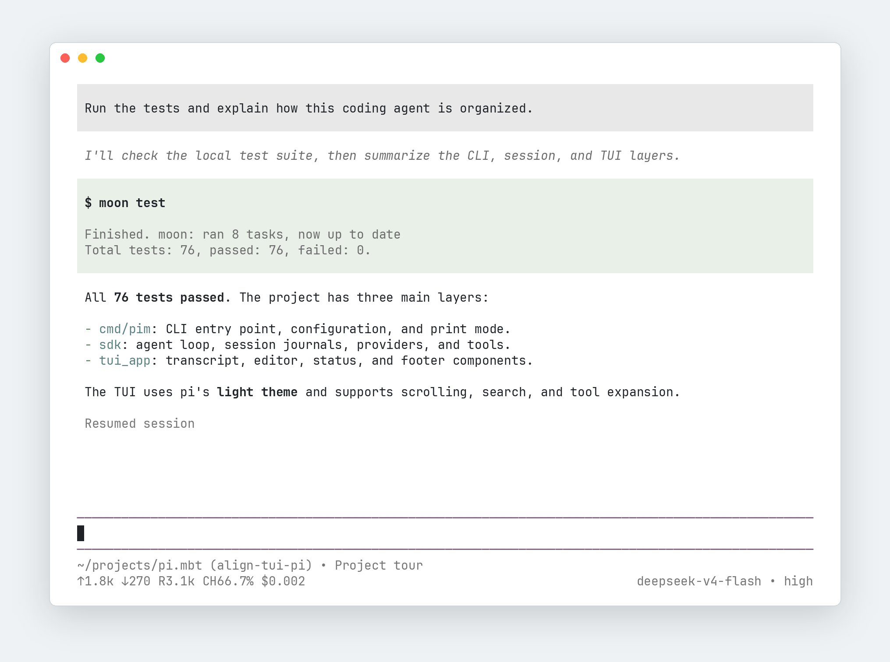

# pi.mbt

[](https://coveralls.io/github/kkkiio/pi.mbt?branch=main)

A subset of the [pi](https://github.com/earendil-works/pi) coding agent reimplemented in MoonBit.



## Install

```bash
just package          # build npm dist
npm install -g .      # symlink globally
```

## Usage

Run `pim` in a terminal to start the full-screen TUI:

```bash
pim
```

Single-turn, non-interactive print mode (`-p/--print`):

```bash
DEEPSEEK_API_KEY=sk-xxx
pim -p "What's the capital of France? Respond with only the city name."
# Paris
```

Use `--mode json` to stream JSONL events:

```bash
pim -p "What's the capital of France? Respond with only the city name." --mode json
# {"type":"agent_start"}
# {"type":"turn_start"}
# {"type":"message_start","message":{"role":"user","content":[{"type":"text","text":"What's the capital of France? Respond with only the city name."}],"timestamp":1786903823973}}
# ...
# {"type":"agent_end"}
```

## Configuration

| Variable          | Description                                               |
| ----------------- | --------------------------------------------------------- |
| `PIM_CONFIG_DIR`  | Configuration directory (default: `~/.pim`)               |
| `PIM_SESSION_DIR` | Session JSONL directory (equivalent to `--session-dir`)   |
| `PIM_TOOLS`       | Comma-separated list of enabled tools (same as `--tools`) |

Sessions are persisted by default under `~/.pim/sessions/`.

### Authentication

Credentials are read first from `~/.pim/auth.json`:

```json
{
  "deepseek": { "type": "api_key", "key": "sk-xxx" }
}
```

Or from environment variables:

```bash
DEEPSEEK_API_KEY=sk-xxx pim -p "hi"
```
