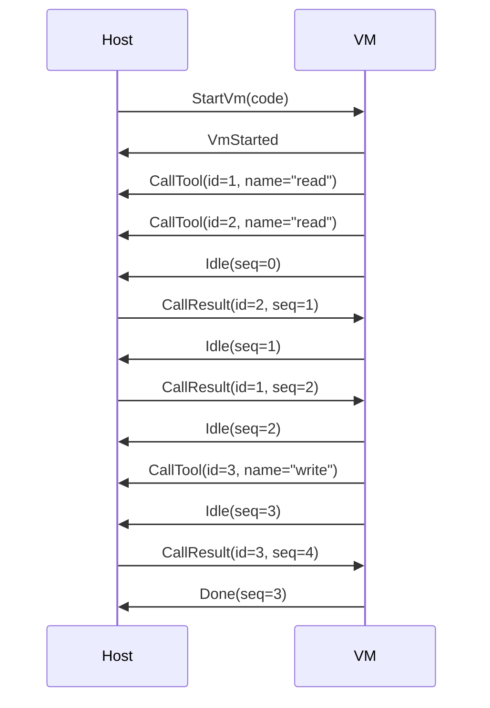

# CodeMode

A tool for running js code in a sandboxed environment.

## VM Communication

The Host and VM communicate through a stream of messages.
For example, the following js code:

```js
const [a, b] = await Promise.all([tools.read("a"), tools.read("b")]);
return await tools.write(a + b);
```

Would be executed as:


