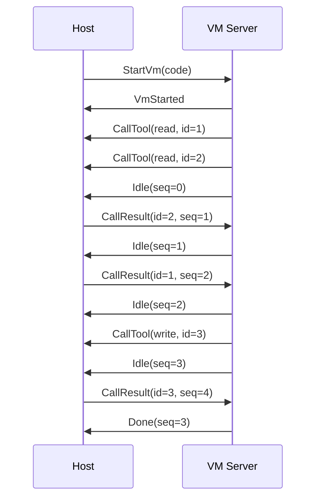

# CodeMode

A tool for running js code in a sandboxed environment.
The protocol is inspired by [pi's codemode-remote](https://github.com/earendil-works/pi/blob/main/packages/codemode/src/runtime/remote.ts).

## Remote VM Server

The Host and VM Server communicate through a stream of messages.
For example, the following js code:

```js
const [a, b] = await Promise.all([tools.read("a"), tools.read("b")]);
return await tools.write(a + b);
```

Would be executed as:



The VM is expected to be isolated from the host and other VMs, both CPU and memory wise.

## Cancellation

`Codemode::execute` owns its VM and nested tool/global tasks. Script completion,
stream failure, and timeout cancel unfinished calls and wait for their cleanup.
The deadline includes VM launch and returns a `Timeout` result with accumulated
output. External task cancellation propagates without producing a result; callers
that own a top-level task may handle it with `async.handle_cancellation`.

Every acquired VM is closed on exit. `VmChannel.close` synchronously releases
the stream and queues a close frame for the remote. A nested tool uses native
cancellation and `defer` for cleanup; necessary asynchronous cleanup may use
`async.protect_from_cancel`.

## Nested tool results

What a nested call resolves to follows pi's `toScriptValue`: a tool that
declares `output_schema` resolves to its `structured_content` — also for error
results that carry one — while any other tool resolves to its text blocks as
one string, and failures reject with an Error carrying the error text.

Images therefore reach scripts through `structured_content`, as an image block
in the shape of the tool's declared schema (pi's `read` does the same);
`image(block)` accepts the block directly. Only explicitly emitted output
reaches the model:

```js
const result = await tools.view_page({ page: 31, bbox: null });
if (result.type === "image") image(result);
text(result.note);
```
