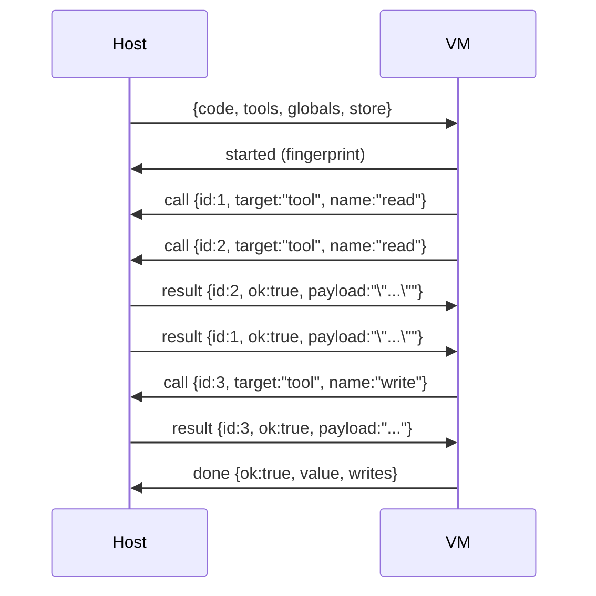

# CodeMode

在沙箱里运行 JS 代码的工具,协议语义对齐 pi (`@earendil-works/pi-codemode`)。

## 结构

- `protocol.mbt` — VM ↔ Host 消息的 JSON 编解码,逐字对齐 upstream `protocol.ts`。
- `remote.mbt` — `Codemode` host:把 `code` 发给一个 `Vm` 流,回答脚本的 tool/global 调用,
  累积 output,组装 `CodemodeResult`。
- `Vm` trait — 上层拥有的全双工流:`send(Json)` / `recv() -> Json` / `close()`。
  `recv` 在流结束时 raise(没有 `None` 哨兵):codemode 语义里,终态帧之前结束的流
  永远是一次失败。

## 消息流(普通模式)

```js
const [a, b] = await Promise.all([tools.read("a"), tools.read("b")]);
return await tools.write(a + b);
```



- call id 由 VM 生成(`nextId++`),host 只原样回带,绝不自己生成。
- 传输可以把多条消息合成一帧(`Json::Array`),`execute` 就地展平——批是无损的,
  不改变消息语义。
- `seq`/`now`/`properties` 只属于 deterministic 回放模式,普通模式一律不发。

## 结果回包的不对称 payload

`result` 的 `payload` 字段按 `ok` 分支编码不同,这是最容易写错的 wire 细节:

- `ok:true` → `payload` 是返回值的 **JSON 文本**;返回 `undefined` 时省略 `payload`
- `ok:false` → `payload` 是错误消息**原文**(VM 侧 `new Error(payload)`,不做 JSON parse)

类型上对应 `CallOutcome::Resolve(value~)` / `Reject(message~, properties~)`,
不一致的状态(比如 `ok:true` 携带 `properties`)在类型上不存在。

## 终态映射

| VM 事件 | `CodemodeResult` |
|---|---|
| `done` `ok:true` | `Ok(value, output, calls, store_writes)` |
| `done` `ok:false` | `Err`, `kind:Script`(解 `name`/`message`/`stack`) |
| `crash`、流提前结束、畸形帧、重复 call id | `Err`, `kind:Sandbox` |
| `failure` | `Err`, error 原样(远端 timeout/OOM) |
| host 侧超时/取消 | 发 `stop` 并关闭流, `kind:Timeout` |

## output 与 calls

- `text()`/`image()`/`console.*` 是 VM prelude 内建,输出作为 `{type:"output"}` 消息发来,
  host 只累积不流式转发;成功和失败的结果都携带到失败点为止的 output。
- 每个 `tools.*` 调用在到达时记入 `calls`(初态 `cancelled`),回包时更新
  `ok`/`error` 与耗时;终态到达时在途调用被取消,记账保持 `cancelled`,
  迟到的回包不再发出。
