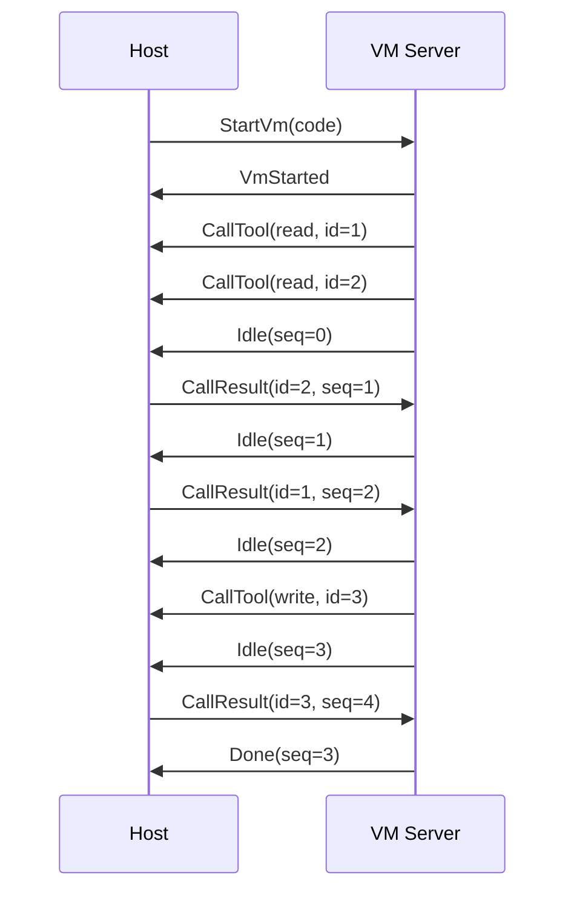

# CodeMode

A tool for running js code in a sandboxed environment.
The protocol is inspired by [pi's codemode-remote](https://github.com/earendil-works/pi/blob/main/packages/codemode/src/runtime/remote.ts).

## Remote VM Server

The Host and VM Server communicate through a stream of messages.
For example, the following js code:

```js
const [a, b] = await Promise.all([tools.read("a"), tools.read("b")]);
return await tools.write(a + b);
```

Would be executed as:



The VM is expected to be isolated from the host and other VMs, both CPU and memory wise.
